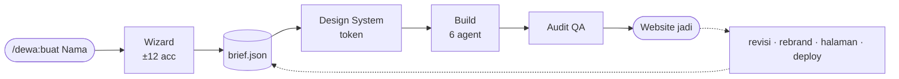

<div align="center">


<br>

[](https://code.claude.com/docs/en/plugins)
[](https://github.com/Kstriabintang/plugin-dewa/blob/main/ROADMAP.md)
[](LICENSE)
[](https://github.com/Kstriabintang/plugin-dewa/blob/main/ROADMAP.md)

**Satu input: nama website.** Sisanya keputusan yang kamu **acc satu per satu** —<br>
lalu Dewa membangun website company-grade dan merawatnya seumur hidup proyek.

[Instalasi](#instalasi) · [Kenapa Dewa](#kenapa-dewa) · [Cara Kerja](#cara-kerja) · [Roadmap](#status--roadmap) · [English](#english)

</div>

---

## Kenapa Dewa?

Kebanyakan AI membangun website dengan menebak seleramu, lalu menyerahkan hasil sekali jadi. Dewa bekerja sebaliknya:

- **Satu input, sisanya pilihan.** Kamu tidak pernah mengetik penjelasan panjang — setiap keputusan (tujuan, bidang, warna, tipografi, gaya UI, motion, konten) ditawarkan sebagai opsi terkurasi dengan preview, dan kamu tinggal acc.
- **Opsi dirancang, bukan template.** Palet dan gaya yang ditawarkan dirancang dinamis dari jawaban-jawabanmu sebelumnya. Dua brief berbeda tidak pernah diberi opsi yang sama.
- **Design-system-first.** Setiap acc menjadi token — bukan nilai hardcode. Ganti tema, seluruh situs ikut.
- **Konten asli.** Copywriting sungguhan sesuai tone brand-mu. Tidak pernah lorem ipsum.
- **Dikerjakan pasukan spesialis.** Arsitektur, desain, copywriting, motion, SEO, dan QA masing-masing ditangani agent khusus — dalam, bukan sambil lalu.
- **Hidup setelah jadi.** Semua keputusanmu tersimpan sebagai `dewa/brief.json`. Revisi satu bagian, tambah halaman, rebrand total — konsistensi terjaga otomatis.

## Cara Kerja



<div align="center">

<br><sub><em>Ilustrasi alur wizard — satu keputusan per langkah, kamu yang pegang kendali.</em></sub>
</div>

<br>

<details>
<summary><strong>Lihat 12 langkah wizard selengkapnya</strong></summary>

<br>

| #  | Langkah              | Yang di-acc                                                   |
|----|----------------------|---------------------------------------------------------------|
| 1  | Tujuan situs         | Business / Personal / Organisasi / Toko                       |
| 2  | Bidang & audiens     | Opsi dinamis menyesuaikan tujuan                              |
| 3  | Kepribadian brand    | Mewah / Profesional / Hangat / Berani                         |
| 4  | Stack kode           | HTML+CSS+JS murni / Astro / Next.js                           |
| 5  | Palet warna          | 4 palet dirancang khusus dari langkah 1–3 (preview swatch)    |
| 6  | Tipografi            | Pasangan font display + body (preview huruf)                  |
| 7  | Gaya UI/UX           | Corporate premium / minimal elegan / bold modern / editorial  |
| 8  | Motion               | Tenang / Hidup / Sinematik                                    |
| 9  | Struktur halaman     | Pilih halaman yang dibutuhkan (multi-select)                  |
| 10 | Section per halaman  | Acc susunan section tiap halaman                              |
| 11 | Bahasa & tone konten | ID / EN / Dwibahasa + gaya penulisan                          |
| 12 | Ringkasan brief      | Acc final sebelum build                                       |

Selalu tersedia opsi **"Other"** di tiap langkah kalau kamu mau isi sendiri.

</details>

## Instalasi

> **Prasyarat:** [Claude Code](https://code.claude.com) sudah terpasang.

Di dalam Claude Code, jalankan:

```
/plugin marketplace add Kstriabintang/plugin-dewa
/plugin install dewa@plugin-dewa
```

Lalu mulai:

```
/dewa:buat NamaWebsiteKamu
```

## Status & Roadmap

Saat ini **v0.1.0 — tahap awal**. Wizard versi perdana sudah bisa dipakai: menuntunmu memutuskan tujuan, bidang, kepribadian brand, dan arah warna — lalu menghasilkan `dewa/brief.json`, fondasi resmi proyek website-mu.

| Milestone | Fokus                                                        | Status         |
|-----------|--------------------------------------------------------------|----------------|
| M0        | Fondasi — plugin valid + wizard perdana                      | ✅ selesai     |
| M1        | Wizard Engine penuh 12 langkah                               | 🔨 berikutnya  |
| M2        | Mesin Design System — brief → token warna/tipografi/motion   | ⬜             |
| M3        | Build Engine — website utuh pertama                          | ⬜             |
| M4        | Pasukan 6 agent spesialis                                    | ⬜             |
| M5        | Toolkit pasca-build — revisi, rebrand, audit, deploy         | ⬜             |
| M6        | Packaging & distribusi penuh                                 | 🔄 sebagian    |
| M7        | Evolusi — modul toko, blog, CMS, i18n                        | ⬜             |

Rencana lengkap dan keputusan arsitektur: **[ROADMAP.md](ROADMAP.md)**

<details>
<summary><strong>Struktur proyek</strong></summary>

```
plugin-dewa/
├── .claude-plugin/plugin.json    # manifest (name: dewa)
├── skills/
│   └── buat/
│       ├── SKILL.md              # wizard — alur acc satu per satu
│       └── references/
│           └── alur-wizard.md    # konstitusi 12 langkah + skema brief.json
├── agents/                       # M4: dewa-arsitek, dewa-desainer, dst.
├── hooks/                        # M5 (opsional)
├── scripts/                      # M3+: validasi & screenshot
└── templates/                    # M3: kerangka per stack
```

Mode pengembangan lokal: lihat [plugin-dewa/README.md](plugin-dewa/README.md)

</details>

## Berkontribusi

Menemukan bug atau punya ide? Buka [issue](https://github.com/Kstriabintang/plugin-dewa/issues) — masukan sangat diterima, terutama dari kamu yang mencoba wizard-nya di kasus nyata.

## Lisensi

[MIT](LICENSE) © [Ksatria Bintang Samudra](https://github.com/Kstriabintang)

---

## English

**Dewa** (Indonesian for *"deity"*) is an all-in-one website factory plugin for [Claude Code](https://code.claude.com). Give it **one input — a website name** — then approve a series of curated decisions one by one: purpose, industry, brand personality, tech stack, color palette, typography, UI style, motion, and content. Every approval becomes part of a design-system brief (`dewa/brief.json`), which a crew of specialist agents uses to build a company-grade website — and keeps using to revise, rebrand, and deploy it consistently for the life of the project.

**Install** (inside Claude Code):

```
/plugin marketplace add Kstriabintang/plugin-dewa
/plugin install dewa@plugin-dewa
/dewa:buat YourWebsiteName
```

Currently at an early milestone (v0.1.0 — the first-run wizard produces the project brief; the full 12-step engine, build engine, and post-build toolkit are being built in stages — see the [roadmap](ROADMAP.md)). The wizard is Indonesian-first; bilingual support is planned.

---

<div align="center">
<sub>Dibuat dengan 🔱 oleh <strong>Ksatria Bintang Samudra</strong></sub>
</div>
