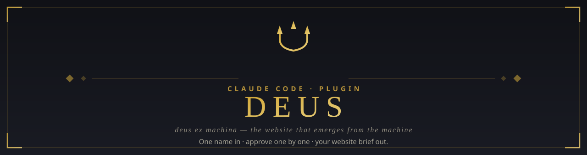
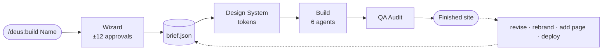
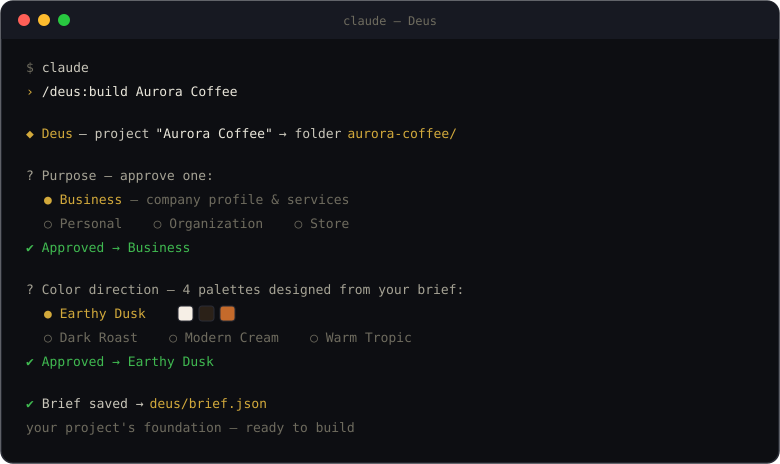

<div align="center">



<br>

[](https://code.claude.com/docs/en/plugins)
[](https://github.com/Kstriabintang/deus-factory/blob/main/ROADMAP.md)
[](LICENSE)
[](https://github.com/Kstriabintang/deus-factory/blob/main/ROADMAP.md)

**One input: a website name.** Everything else is a curated decision you **approve one by one**.<br>
Today Deus turns those decisions into a project brief; building the full website is the next stage on the [roadmap](#status--roadmap).

[Install](#install) · [Why Deus](#why-deus) · [How it works](#how-it-works) · [Roadmap](#status--roadmap) · [Contributing](#contributing)

</div>

---

## Why Deus?

Most AI website tools guess your taste and hand back a finished result in one shot. Deus works the other way around — *deus ex machina*, the god who emerges from the machine, one decision at a time.

**Works today (v0.1)**

- **One input, everything else is a choice.** You never write long explanations — each decision is offered as curated options you approve.
- **Options are designed, not templated.** Each step's options are generated from your earlier answers, so two different briefs are never offered the same options.
- **A brief you keep.** Every approval is saved to `deus/brief.json`, the project's single source of truth.

**On the roadmap**

- **The full 12-step wizard** — stack, typography, UI style, motion, pages, sections, and content tone.
- **Design-system-first build.** Every approval becomes a token, not a hardcoded value. Change the theme, the whole site follows.
- **Real content.** Genuine copywriting in your brand's tone, never lorem ipsum.
- **A specialist crew.** Architecture, design, copywriting, motion, SEO, and QA, each handled by a dedicated agent.
- **Alive after launch.** Revise one section, add a page, or rebrand — consistency preserved through the brief.

## How it works

The target pipeline is below. **v0.1 implements the first stage** — the wizard and `brief.json`; everything after it is in development.



<div align="center">

<br><sub><em>The wizard flow — one decision per step, you stay in control.</em></sub>
</div>

<br>

<details>
<summary><strong>See the full 12-step wizard</strong></summary>

<br>

| #  | Step                    | What you approve                                              |
|----|-------------------------|---------------------------------------------------------------|
| 1  | Purpose                 | Business / Personal / Organization / Store                    |
| 2  | Industry & audience     | Dynamic options that match the purpose                       |
| 3  | Brand personality       | Luxurious / Professional / Warm / Bold                        |
| 4  | Tech stack              | Plain HTML+CSS+JS / Astro / Next.js                           |
| 5  | Color palette           | 4 palettes designed from steps 1–3 (swatch preview)          |
| 6  | Typography              | Display + body font pairing (type specimen)                  |
| 7  | UI/UX style             | Corporate premium / minimal elegant / bold modern / editorial |
| 8  | Motion                  | Calm / Lively / Cinematic                                    |
| 9  | Page structure          | Pick the pages you need (multi-select)                       |
| 10 | Sections per page       | Approve the section order of each page                       |
| 11 | Content language & tone | EN / ID / Bilingual + writing style                          |
| 12 | Brief summary           | Final approval before the build                              |

An **"Other"** option is always available at every step if you'd rather write your own.

</details>

## Install

> **Prerequisite:** [Claude Code](https://code.claude.com) installed.

Inside Claude Code 2.1.275 or later, run:

```
/plugin install deus --marketplace Kstriabintang/deus-factory
```

On any version:

```
/plugin marketplace add Kstriabintang/deus-factory
/plugin install deus@deus-factory
```

Then start:

```
/deus:build YourWebsiteName
```

## Status & Roadmap

Currently **v0.1.1 — early stage**. The first-run wizard already works: it walks you through purpose, industry, brand personality, and color direction — then produces `deus/brief.json`, the official foundation of your website project.

| Milestone | Focus                                                        | Status         |
|-----------|--------------------------------------------------------------|----------------|
| M0        | Foundation — valid plugin + first-run wizard                 | ✅ done        |
| M1        | Full 12-step wizard engine                                   | 🔨 next        |
| M2        | Design-system engine — brief → color/type/motion tokens      | ⬜             |
| M3        | Build engine — first complete website                        | ⬜             |
| M4        | Crew of 6 specialist agents                                  | ⬜             |
| M5        | Post-build toolkit — revise, rebrand, audit, deploy          | ⬜             |
| M6        | Full packaging & distribution                                | 🔄 partial     |
| M7        | Evolution — store, blog, CMS, i18n modules                   | ⬜             |

Full plan and architecture decisions: **[ROADMAP.md](ROADMAP.md)**

<details>
<summary><strong>Project structure</strong></summary>

```
deus/
├── .claude-plugin/plugin.json    # manifest (name: deus)
└── skills/
    └── build/
        ├── SKILL.md              # wizard — approve-one-by-one flow
        └── references/
            └── wizard-flow.md    # 12-step constitution + brief.json schema
```

Local development mode: see [deus/README.md](deus/README.md)

</details>

## Contributing

Found a bug or have an idea? Open an [issue](https://github.com/Kstriabintang/deus-factory/issues) — feedback is very welcome, especially from anyone trying the wizard on a real project.

## License

[MIT](LICENSE) © [Ksatria Bintang Samudra](https://github.com/Kstriabintang)

---

<div align="center">
<sub>Built with 🔱 by <strong>Ksatria Bintang Samudra</strong></sub>
</div>
